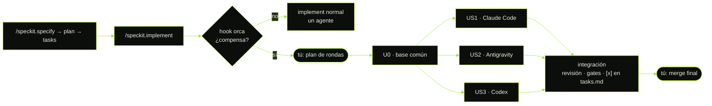

<div align="center">

<a href="https://fernandobaqueroo.github.io/orca-multiagent-kit/"></a>

<sub>Pulsa el banner para abrir la versión interactiva.</sub>

# Orca Multiagent Kit

**Una sola fuente de reglas y skills para todos tus agentes de programación.<br>Calidad profesional en cada tarea, y varios agentes trabajando en paralelo sin pisarse.**

[](https://github.com/FernandoBaqueroo/orca-multiagent-kit/releases/latest)
[](https://github.com/FernandoBaqueroo/orca-multiagent-kit/actions/workflows/ci.yml)
[](LICENSE)
[](https://github.com/FernandoBaqueroo/orca-multiagent-kit/releases)


[](https://www.npmjs.com/package/orca-multiagent-kit)

[**Descargar ZIP**](https://github.com/FernandoBaqueroo/orca-multiagent-kit/releases/latest/download/orca-multiagent-kit.zip) · [Web interactiva](https://fernandobaqueroo.github.io/orca-multiagent-kit/) · [Guía visual](https://fernandobaqueroo.github.io/orca-multiagent-kit/guia.html) · [Manual](docs/MANUAL.md) · [Changelog](CHANGELOG.md)

</div>

```bash
npx orca-multiagent-kit install
```

---

## Índice

- [Qué es](#que-es)
- [Instalar](#instalar)
- [Comandos `omk`](#comandos)
- [Agentes soportados](#agentes)
- [Skills](#skills)
- [Flujo de trabajo](#flujo)
- [Estructura del repositorio](#estructura)
- [Documentación](#documentacion)
- [Contribuir](#contribuir)
- [Autores](#autores)
- [Licencia](#licencia)

<a id="que-es"></a>
##  Qué es

**Orca Multiagent Kit** reúne en `~/.agents/` las reglas y skills de todos tus agentes de programación. Tiene dos partes:

| Parte | Qué aporta |
|:--|:--|
| **CSR — Claude Session Rules** | Código de calidad profesional, auditado en seguridad (OWASP Top 10 2025, ASVS 5.0, CWE Top 25) y con tests. Una puerta de validez en 8 fases y una tabla de gates al cerrar cada tarea. Respuestas mínimas: el agente gasta tokens en pensar, no en hablar. |
| **MAW — Multi-Agent Work** | Varios agentes a la vez sin pisarse, sin que tengas que coordinarlos. El agente detecta cuándo una tarea se puede repartir, la divide, lanza un agente por parte en su propio worktree ([Orca](https://www.onorca.dev), subagentes nativos o worktrees a mano) e integra el resultado. Con spec-kit, `/speckit.implement` lo hace solo. |

| Sin el kit | Con el kit |
|:--|:--|
| Una copia de las reglas por agente, que acaban divergiendo | **Una fuente**: cada agente importa o enlaza `~/.agents` |
| Claude cargaba todas las reglas en **cada mensaje** | Reglas **bajo demanda**; solo un núcleo de ~80 líneas está siempre cargado |
| Un agente, una tarea cada vez | Varios agentes en paralelo, con coordinador, informes e integración segura |

<a id="instalar"></a>
##  Instalar

**Un comando lo instala todo y otro lo actualiza todo**, llegue el kit como llegue. `omk setup` deja las reglas y las skills en `~/.agents`, cada agente enlazado a ellas, `omk` en el PATH y, si usas Orca, su plugin y su panel (te enseña lo que pide y te pregunta antes de aprobarlo). `omk update` pone al día el kit, `~/.agents`, el proyecto de la carpeta actual y el plugin. Todo se hace con backup y se deshace con `omk restore`.

**1. npx** (Node ≥ 18)
```bash
npx orca-multiagent-kit setup --dry-run   # qué haría
npx orca-multiagent-kit setup
```
Deja `omk` instalado (`npm install -g`), porque el plugin de Orca lo usa desde el PATH. Es lo mismo que `npm install -g orca-multiagent-kit && omk setup`.

**2. Ejecutable** (sin Node): descarga el de tu sistema desde la [última release](https://github.com/FernandoBaqueroo/orca-multiagent-kit/releases/latest) (`omk-windows-x64.exe`, `omk-macos-arm64`, `omk-linux-x64`) y ábrelo: hace `omk setup`. Con `omk update` se descarga a sí mismo la versión nueva, comprobando su SHA-256. Detalle: [`docs/EJECUTABLE.md`](docs/EJECUTABLE.md).

**3. curl** (sin Node): baja ese mismo ejecutable, comprueba su SHA-256 y hace `omk setup`
```bash
curl -fsSL https://raw.githubusercontent.com/FernandoBaqueroo/orca-multiagent-kit/main/scripts/get.sh | bash
```

**4. ZIP o clon** (sin Node y sin ejecutable para tu sistema): instala las reglas y las skills; no hay `omk` ni plugin de Orca, y se actualiza repitiéndolo
```bash
curl -LO https://github.com/FernandoBaqueroo/orca-multiagent-kit/releases/latest/download/orca-multiagent-kit.zip
unzip orca-multiagent-kit.zip && cd orca-multiagent-kit
./install.sh --dry-run && ./install.sh
```
Cada [release](https://github.com/FernandoBaqueroo/orca-multiagent-kit/releases) publica `orca-multiagent-kit-vX.Y.Z.zip` con `SHA256SUMS` y cada ejecutable con su `.sha256`. Para comprobar la integridad: `shasum -a 256 -c SHA256SUMS`.

¿Solo las reglas y las skills, sin tocar Orca? `omk install` (o `npx orca-multiagent-kit install`).

Después, reinicia tus agentes y escribe en cada proyecto **«inicializa el proyecto»**. La skill `kit-init` detecta el stack leyendo el repo, crea `AGENTS.md`, `STACK.md` y `ORCHESTRATION.md`, y te hace como mucho 4 preguntas.

Requisitos: macOS, Linux, WSL o Git Bash, con bash ≥ 3.2.

<a id="comandos"></a>
##  Comandos `omk`

| Comando | Qué hace |
|:--|:--|
| `omk setup [--yes] [--dry-run]` | **Lo instala todo**: reglas y skills en `~/.agents`, `omk` en el PATH, plugins de Orca encendidos, plugin del kit y su panel |
| `omk install [--agents a,b] [--dry-run]` | Solo la fuente única (`~/.agents`) para los agentes detectados; si el plugin de Orca ya está instalado, lo deja en la versión del kit |
| `omk plugin install\|status\|uninstall` | El plugin de Orca del kit; `install` pide tu aprobación (o `--yes`) |
| `omk run <subcomando>` | El motor de los runs de la skill `orca`: `plan` (rondas y si compensa), `start` (base fresca), `worktree`, `check` (alcance), `merge` y `cleanup`, con el estado en `.work/runs/<run>/run.md` (`omk run help`) |
| `omk gate on\|off\|status` | La puerta de reparto obligatoria de Claude Code: tras cargar la skill `orca`, no se edita hasta que su veredicto esté registrado y, si reparte, hasta que respondas al plan |
| `omk team` · `omk team set …` | Enseña o cambia el equipo de roles del proyecto (`ORCHESTRATION.md` §1): proveedores, revisión cruzada y proveedor por rol |
| `omk init [ruta]` | Prepara un proyecto (por defecto, la carpeta actual) |
| `omk verify` | Comprueba enlaces, imports y que no queden copias divergentes |
| `omk adopt <carpeta-skill>` | Comparte una skill externa (p. ej. impeccable) con todos los agentes |
| `omk backups` | Lista las copias de seguridad |
| `omk restore <fecha>` | Deshace una instalación |
| `omk update [--yes] [--offline]` | **Lo actualiza todo**: el kit (npm, o el ejecutable, que se descarga a sí mismo), `~/.agents`, el proyecto de la carpeta actual (bloques de `AGENTS.md`/`CLAUDE.md`, ficheros que falten y lo que estrenen las plantillas de `ORCHESTRATION.md` y `STACK.md`, sin tocar lo escrito) y el plugin de Orca. `--offline` reaplica esta versión sin descargar nada |
| `omk where` · `omk version` · `omk help` | Rutas, versión y ayuda |

Con el zip o un clon, `install`, `init`, `verify`, `adopt` y `restore` tienen su equivalente en `./install.sh` (`--project-only`, `--verify`, `--adopt`, `--restore`, `--dry-run`); `setup`, `update`, `plugin` y `team` necesitan `omk`.

<a id="agentes"></a>
##  Agentes soportados

| Agente | Reglas globales | Skills | Estado |
|:--|:--|:--|:--|
|  | `@~/.agents/AGENTS.md` importado en `~/.claude/CLAUDE.md` | enlaces en `~/.claude/skills` | soportado |
|  | `~/.gemini/GEMINI.md` → enlace | enlaces en `~/.gemini/config/skills` | soportado |
|  | `~/.codex/AGENTS.md` → enlace | nativo en `~/.agents/skills` | soportado |
|  | `~/.copilot/copilot-instructions.md` → enlace | nativo en `~/.agents/skills` | soportado |
|  | una línea en *Settings → Rules* (no usa ficheros) | nativo en `~/.agents/skills` | soportado |
|  | `~/.config/devin/AGENTS.md` → enlace | — | opcional (`--agents devin`) |

En cada proyecto, las reglas van en `AGENTS.md`, que leen todos los agentes. `CLAUDE.md` solo contiene `@AGENTS.md`.

<a id="skills"></a>
##  Skills

Solo tienes que conocer dos frases. El resto lo deciden los agentes.

| Skill | Cuándo se usa | Cómo |
|:--|:--|:--|
| `kit-init` | Proyecto nuevo, o con reglas antiguas | «inicializa el proyecto» |
| `orca` | Tareas con varias partes independientes: user stories, sprints, módulos, pantallas | **Sola**, por iniciativa del agente. O «hazlo en paralelo», «carrera entre Claude y Gemini», «planifica en sprints» |
| `speckit-orca-implement` | Hook de spec-kit: decide si `/speckit.implement` se reparte | **Automática** al escribir `/speckit.implement` |
| `csr-stack` · `csr-gate` · `csr-audit` | Ficha del stack, puerta de validez, auditoría de seguridad | Automáticas al cerrar tareas, o «pasa los gates» / «audita» |

**Autonomía** (en `ORCHESTRATION.md`): `semi` por defecto. Confirmas el plan de rondas, el merge final y la limpieza, y nada más salvo decisiones de producto. `manual` pide confirmación en cada ronda; `auto`, solo el merge final y la limpieza. En ningún nivel se mergea a la rama por defecto, se hace push ni se borran worktrees o ramas sin tu confirmación.

**Olimpo: roles y modelos.** Cada unidad recibe un rol (arquitectura, seguridad, código sensible, datos, interfaz, verificación, mecánico…) y de él sale el nivel de modelo: `alto`, `medio` o `bajo`. Qué modelo es cada nivel en cada proveedor lo dice un fichero tuyo, `~/.agents/models.md`, que el kit crea una vez y no vuelve a tocar: cuando sale un modelo nuevo no hay que reinstalar ni reinicializar nada. El plan de rondas enseña el rol, el modelo y el recurso (subagente, worker de Orca…) de cada unidad antes de que digas «sí». Detalle: [`docs/OLIMPO.md`](docs/OLIMPO.md).

**Worktrees sanos.** Cada run parte de `origin` actualizado (nunca de una rama local desfasada), cada worktree nace con sus dependencias y su `.env` de desarrollo, y al terminar el coordinador enseña qué worktrees, ramas y copias de entorno han quedado y los borra con tu permiso.

Convive con skills externas como **impeccable**, **supabase**, **spec-kit** y las de la app **Orca**: cada una manda en su terreno, y la puerta de validez y las prohibiciones se aplican siempre.

**Plugin de Orca** (opcional, Orca ≥ 1.4.248): `omk verify`, «inicializa el proyecto» y `omk update` en la paleta de comandos y en un panel lateral, *Multiagent Kit*, que enseña el estado y la salida de cada acción mientras corre y además los agentes con nombre y su ficha (unidad, rol, rama, estado…), configura el equipo de roles (también roles propios), reparte una tarea entre agentes (sin necesidad de spec-kit) y cambia los ajustes del plugin (los mismos de *Settings → Plugins*); el contrato del worker añadido a cada despacho de orquestación del kit, avisos de agentes bloqueados y de runs terminados, y los agentes activos en la barra de estado. Se instala con `omk plugin install` (o `omk setup`). Detalle, permisos que pide y cómo desactivarlo: [`docs/PLUGIN-ORCA.md`](docs/PLUGIN-ORCA.md).

<a id="flujo"></a>
##  Flujo de trabajo

**Con spec-kit** haces tus specs como siempre. Al implementar, el kit reparte el trabajo solo:



**Sin spec-kit** es lo mismo: pide la tarea con normalidad («añade el módulo de notificaciones») y, si tiene partes independientes, el agente propone el reparto. Un plan por sprints, un plan del modo plan de Claude o de Antigravity, o un mockup sirven igual de entrada.

**Las reglas que nunca se rompen:**
- Una unidad = un worktree = una rama.
- Los ficheros compartidos los toca una sola unidad por ronda.
- Los workers no editan `tasks.md`, planes ni `STACK.md`, y no hacen merge.
- Sin informe no hay unidad.
- Nunca `PASS` de algo no ejecutado.
- Ningún worktree nace de una rama local sin contrastarla con `origin`.
- Nada se borra sin tu permiso, y nada integrado se queda sin ofrecerte borrarlo.
- Lo pequeño no se orquesta.

<a id="estructura"></a>
##  Estructura del repositorio

```text
orca-multiagent-kit/
├── bin/                    CLI omk (npm / npx / ejecutable), sin dependencias: omk · setup · update · fetch · sync · team · orca · ui · sea
├── core/AGENTS.md          núcleo siempre cargado (~80 líneas)
├── rules/                  00-router … 95-multi-agent  +  lang/ (17 lenguajes)
├── skills/                 kit-init · orca · speckit-orca-implement · csr-*
├── speckit-extension/      extensión de spec-kit (hook before_implement)
├── templates/              AGENTS.md · CLAUDE.md · STACK.md · ORCHESTRATION.md · orca.yaml · .worktreeinclude · claude-settings.json · models.md
├── output-styles/          csr-minimal (Claude Code)
├── orca-plugin/            plugin de Orca: comandos y panel del kit, contrato del worker, barra de estado
├── install.sh              instala · migra · verifica · restaura · adopta
├── GUIA.html               guía visual del flujo
├── site/                   web interactiva (GitHub Pages)
├── docs/MANUAL.md          manual completo
├── AI_INSTALL.md           instrucciones para que una IA lo instale
├── tests/                  pruebas del instalador, del CLI, de omk team, de omk setup y plugin (doble de Orca), de omk update, de spec-kit y del ejecutable
├── scripts/                check.sh · build-release.sh · build-exe.js · get.sh · banner.py
└── .github/                CI (Linux + macOS; ejecutable también en Windows), releases con zip y ejecutables, web, plantillas
```

<a id="documentacion"></a>
##  Documentación

| Documento | Para quién |
|:--|:--|
| [Web interactiva](https://fernandobaqueroo.github.io/orca-multiagent-kit/) | Presentación, instalación y comandos |
| [Guía visual](https://fernandobaqueroo.github.io/orca-multiagent-kit/guia.html) ([`GUIA.html`](GUIA.html)) | El flujo de trabajo completo, con esquemas |
| [`docs/MANUAL.md`](docs/MANUAL.md) | Instalación detallada, migración, convivencia y problemas frecuentes |
| [`AI_INSTALL.md`](AI_INSTALL.md) | Una IA que tiene que instalar o integrar el kit |
| [`docs/OLIMPO.md`](docs/OLIMPO.md) | Roles, niveles de modelo, recurso por unidad y ciclo de vida de los worktrees |
| [`docs/PLUGIN-ORCA.md`](docs/PLUGIN-ORCA.md) | Quien usa Orca y quiere el kit integrado en la app |
| [`docs/EJECUTABLE.md`](docs/EJECUTABLE.md) | Quien quiere preparar Orca de una vez (`omk setup` o el ejecutable), o construir el ejecutable |
| [`CHANGELOG.md`](CHANGELOG.md) | Historial de versiones ([SemVer](https://semver.org/lang/es/)) |

<a id="contribuir"></a>
##  Contribuir

Las contribuciones son bienvenidas. Lee [`CONTRIBUTING.md`](CONTRIBUTING.md): principios, cómo añadir skills o reglas, versionado y releases. Antes de abrir un PR:

```bash
npm test     # check.sh y todas las pruebas de tests/ menos la del ejecutable
```

[Código de conducta](CODE_OF_CONDUCT.md) · [Seguridad](SECURITY.md) · [Soporte](SUPPORT.md)

<a id="autores"></a>
##  Autores

<table>
  <tr>
    <td align="center" width="50%" valign="top">
      <a href="https://github.com/Necro-Coder"><br><b>Necro-Coder</b></a><br>
      <sub>Autor de <b>CSR — Claude Session Rules</b></sub>
      <p align="left"><sub>Diseñó la base de calidad del kit: el protocolo de respuesta de consumo mínimo, la carga progresiva de reglas, la puerta de validez en 8 fases, los módulos de clean code, seguridad (OWASP, ASVS, CWE), testing, rendimiento, fiabilidad y cadena de suministro, las 17 guías por lenguaje y las skills <code>csr-stack</code>, <code>csr-gate</code> y <code>csr-audit</code>.</sub></p>
    </td>
    <td align="center" width="50%" valign="top">
      <a href="https://github.com/FernandoBaqueroo"><br><b>Fernando Baquero</b></a><br>
      <sub>Autor de <b>Orca Multiagent Kit</b> y <b>MAW — Multi-Agent Work</b></sub>
      <p align="left"><sub>Convirtió CSR en una fuente única para varios proveedores (Claude Code, Antigravity, Codex, Copilot, Cursor y Devin). Creó la capa de orquestación multiagente (unidades de trabajo, worktrees, Orca y spec-kit), <code>kit-init</code>, el CLI <code>omk</code>, el instalador con migración, verificación y restauración, y la guía visual.</sub></p>
    </td>
  </tr>
</table>

<a id="licencia"></a>
##  Licencia

[MIT](LICENSE) © 2026 Fernando Baquero y Necro-Coder.

Las marcas Claude, Gemini/Antigravity, Codex/OpenAI, GitHub Copilot, Cursor y Orca pertenecen a sus respectivos propietarios. Se usan solo para indicar compatibilidad; este proyecto no está afiliado a ninguno de ellos.
